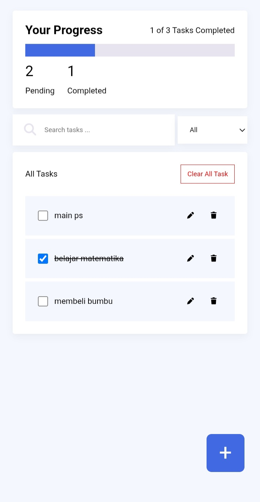
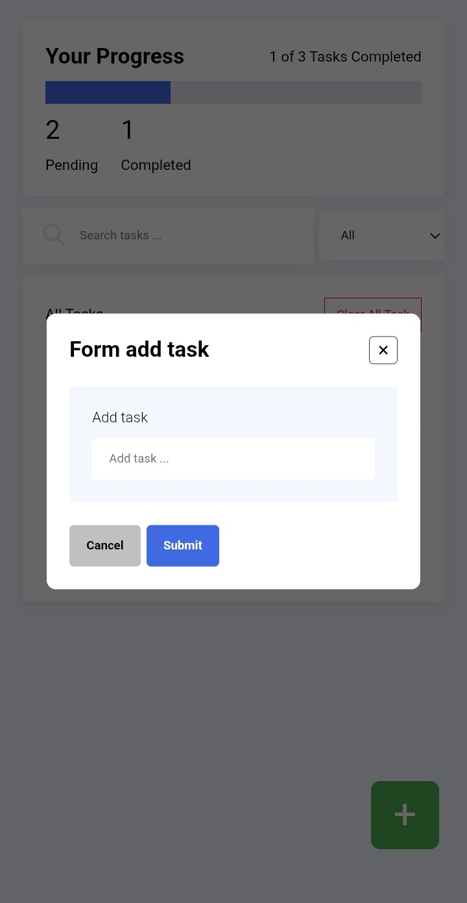

# Todolist v1.1

dibuat menggunakan html, css dan javascript. program todolist ini memiliki fitur seperti filter konten berdasarkan input pencarian dan input select.

## Dibuat menggunakan

* HTML
* CSS
* JAVASCRIPT

## Tools lainnya

* [FontAwesome](https://fontawesome.com)
* [SweetAlert2](https://sweetalert2.github.io)

## Kontributor

* Candra Dwi Cahyo

  * [Facebook](https://facebook.com/candradwicahyo18)
  * [Intagram](https://instagram.com/candradwicahyo18)

## Preview & demo

[Tekan link ini](https://candradwicahyo.github.io/todolist-v1.1) untuk mencoba demo program ini
